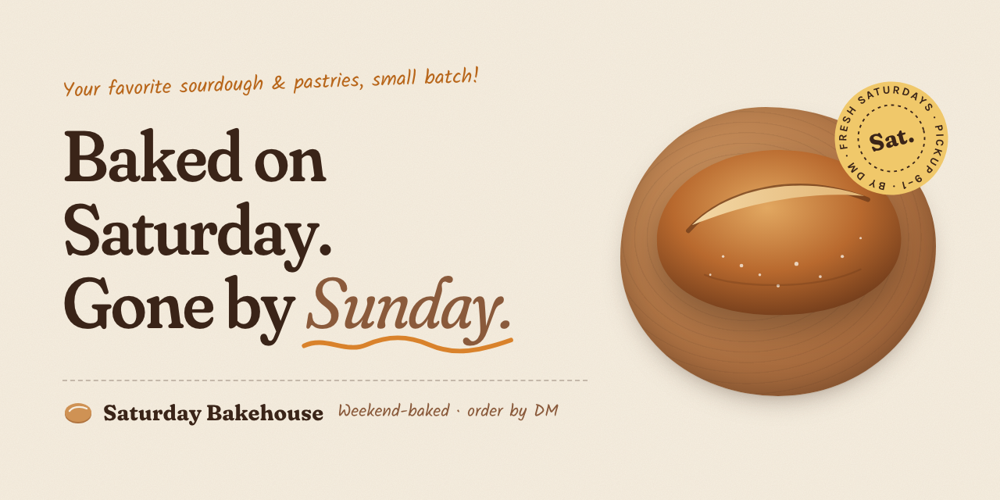

# Saturday Bakehouse



A homepage for **Saturday Bakehouse**, a small-batch bakery that bakes naturally leavened sourdough and hand-laminated pastries once a week, on Saturday morning. Customers order by sending an Instagram DM during the week and pick up their order warm on Saturday.

The site is meant to feel handmade and warm rather than like a generic bakery template. The menu looks like a taped-up paper bake list, the story sits next to a polaroid of the sourdough starter, and the order form writes the customer's DM for them.

It's plain HTML, CSS and JavaScript, with no framework, build step or backend.

## Features

- **Hero:** "Baked on Saturday. Gone by Sunday." with a loaf illustration and a rotating "Sat." pickup badge.
- **Live order status:** a strip under the hero shows whether DMs are open for this Saturday, or when orders open for the next one. It works this out from the current date (orders close Thursday at 8pm).
- **Bake sheet menu:** loaves and pastries with prices, descriptions and handwritten tags like "sells out" and "vegan". The date at the top is always the upcoming bake day.
- **The weekend rhythm:** a four-step timeline showing how an order goes from DM to Saturday pickup.
- **About story:** how the bakery started with a jar of starter called Doris, plus three quick facts.
- **DM-to-order form:** customers pick quantities, add their name, a pickup window and notes, and see their message written out live with an estimated total. One button copies the message and opens an Instagram DM. Instagram doesn't let websites pre-fill a DM, so customers paste it in. Nothing is charged online; payment happens at pickup.
- **Responsive and accessible:** works down to phone width, supports keyboard use with visible focus outlines, and turns off animations for people who prefer reduced motion.

## Project structure

```
.
├── index.html               # Page markup
├── css/
│   └── styles.css           # All site styles
├── js/
│   └── script.js            # Menu data, order status, DM-to-order form
├── assets/
│   ├── social-preview.png   # 1280×640 GitHub social card
│   ├── social-preview.html  # Source for the social card
│   └── social-preview.css
└── .claude/
    └── launch.json          # Local preview server config
```

## Running locally

Opening `index.html` directly in a browser works. To serve it the way it will run online:

```bash
python3 -m http.server 4173
```

Then visit http://localhost:4173.

## Updating the site

Most weekly changes happen at the top of [`js/script.js`](js/script.js):

| What | Where |
|---|---|
| Instagram handle | `IG_HANDLE` |
| Currency symbol | `CURRENCY` |
| Menu items, prices, descriptions, tags | the `MENU` list |

The menu section and the order form both read from `MENU`, so an item only needs to be added, changed or removed in one place. Tags use one of three styles: `["sells", "…"]`, `["vegan", "…"]` or `["new", "…"]`.

Pickup details, the story and footer text are in [`index.html`](index.html). Colors and fonts are defined as variables at the top of [`css/styles.css`](css/styles.css).

> **Before launch:** the pickup address in the footer, the starter's backstory and the prices are placeholders, so swap in the real ones.

## Social preview

`assets/social-preview.png` (1280×640) is the GitHub repo social card. Upload it under
**Settings → General → Social preview**.

To re-render it after editing `assets/social-preview.html` / `.css`, serve the folder
(`python3 -m http.server 4173`) and run:

```bash
"/Applications/Google Chrome.app/Contents/MacOS/Google Chrome" --headless=new --hide-scrollbars \
  --force-device-scale-factor=1 --window-size=1280,640 --virtual-time-budget=5000 \
  --screenshot="$PWD/assets/social-preview.png" http://localhost:4173/assets/social-preview.html
```

## Built with

- HTML, CSS and JavaScript
- [Fraunces](https://fonts.google.com/specimen/Fraunces), [Karla](https://fonts.google.com/specimen/Karla) and [Kalam](https://fonts.google.com/specimen/Kalam) from Google Fonts
- Built with [Claude Code](https://claude.com/claude-code)
